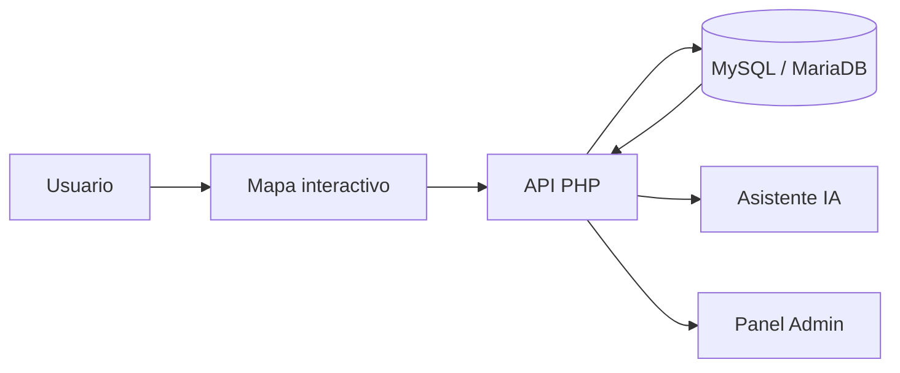

# MyGTS

<p align="center">
	<strong>Planificación de rutas con enfoque en seguridad ciudadana para la Ciudad de Guatemala.</strong><br>
	Busca paradas, calcula rutas multimodales, visualiza puntos de seguridad y guarda trayectos desde un mapa interactivo.
</p>

<p align="center">
	
	
	
	
</p>

## Visión

MyGTS es una plataforma web de planificación urbana que prioriza la seguridad además del tiempo de viaje. El sistema combina transporte público y caminatas, muestra la información en un mapa interactivo y permite consultar rutas, paradas, puntos de seguridad y reportes colaborativos.

## Lo que puedes hacer

- Buscar paradas y rutas por nombre o dirección.
- Calcular trayectos multimodales entre origen y destino.
- Ver rutas, paradas y puntos de seguridad sobre el mapa.
- Guardar rutas y ubicaciones frecuentes.
- Reportar zonas de seguridad desde la propia app.
- Consultar al asistente IA para orientación contextual.

## Vista general



## Tecnologías

| Capa | Tecnologías |
|---|---|
| Frontend | JavaScript vanilla, Bootstrap 5, Leaflet, OpenStreetMap |
| Backend | PHP 8+, sesiones, PDO |
| Datos | MySQL / MariaDB |
| Integraciones | OSRM, OpenRouter |

## Estructura del proyecto

- `index.php`: vista principal con el mapa.
- `login.php`, `registro.php`, `logout.php`: autenticación.
- `admin.php`: acceso al panel de administración.
- `api/`: endpoints para rutas, paradas, seguridad, reportes y sesión.
- `config/`: conexión a base de datos, entorno y autenticación.
- `css/`: estilos visuales.
- `js/`: lógica del frontend.
- `database/`: esquemas SQL y migraciones.

## Requisitos

- PHP 8.0 o superior.
- Extensiones `PDO` y `pdo_mysql`.
- MySQL 8+ o MariaDB 10.5+.
- Un servidor compatible con PHP como Apache.

## Instalación local

1. Clona o descarga el proyecto en tu servidor local.
2. Importa la base de datos desde `database/`.
3. Copia `.env.example` como `.env` y configura tus credenciales.
4. Verifica que `pdo_mysql` esté habilitado.
5. Abre `index.php` desde tu entorno local.

## Configuración del entorno

El proyecto usa un archivo `.env` en la raíz.

```env
DB_HOST=127.0.0.1
DB_NAME=ExpoCarrera
DB_USER=root
DB_PASS=
DB_CHARSET=utf8mb4
OPENROUTER_API_KEY=tu_clave_aqui
```

No subas tu `.env` real al repositorio.

## Base de datos

Archivos útiles dentro de `database/`:

- `esquema_completo.sql`: esquema general del sistema.
- `esquema_completo_infinityfree.sql`: variante para hosting compatible.
- `esquema_completo_infinityfree_db.sql`: variante para importar dentro de una base ya creada.
- `crear_admin_produccion.sql`: crea el administrador inicial.
- `migracion_roles.sql` y `migracion_mas_rutas.sql`: ajustes de estructura.

## Despliegue

Si quieres publicarlo en InfinityFree u otro hosting similar, revisa la guía completa en [GUIA_DESPLIEGUE_INFINITYFREE.md](GUIA_DESPLIEGUE_INFINITYFREE.md).

## Seguridad y notas

- Protege siempre el archivo `.env`.
- No expongas el directorio `database/` en producción.
- El asistente IA requiere una clave válida de OpenRouter.
- El panel de administración debe mantenerse restringido a usuarios autorizados.

## Estado del proyecto

MyGTS está pensado como base sólida para una demostración funcional y evolutiva. La arquitectura ya separa frontend, backend, autenticación, rutas, reportes y administración, así que es un buen punto de partida para publicar, probar y seguir iterando.
